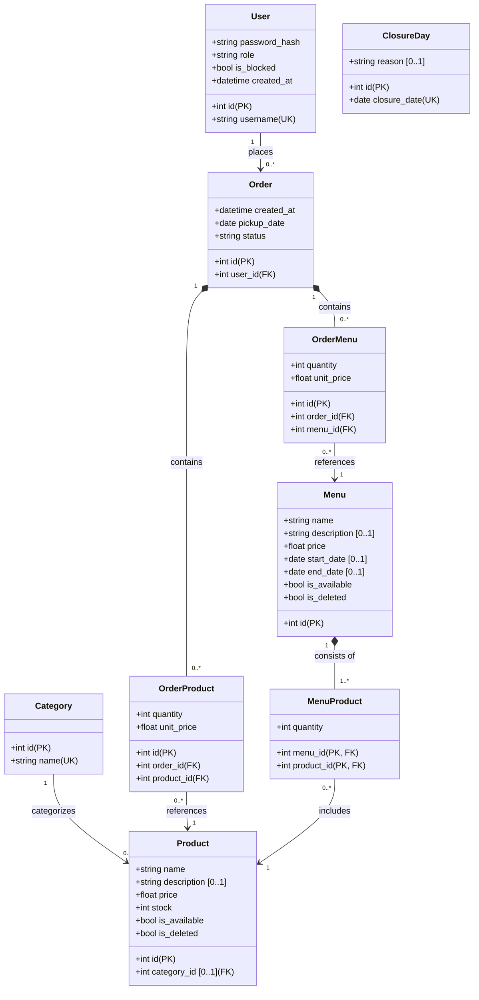

# Pol-eat-heck — Base de données (`4a-isi-projet-db`)

Modélisation, schémas SQLite/SQLModel et scripts d'administration de l'application de réservation de menus **Pol-eat-heck**.

## Équipe & Dépôts liés

* **Collaborateurs :** (`@Tolram89`), (`Natkbz`), (`dcr29`)
* **Back-end (FastAPI) :** [4a-isi-projet-back](https://github.com/Natkbz/4a-isi-projet-back) 
* **Front-end (HTML/CSS/JS) :** [4a-isi-projet-front](https://github.com/dcr29/4a-isi-projet-front)

## Conception de la base de données (MLD / UML)

    
    
    